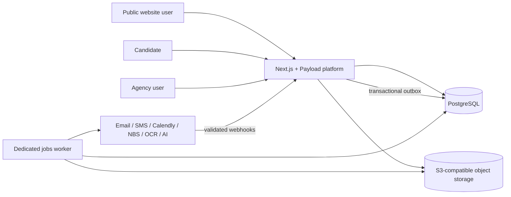

# ADR-0002: Adopt a modular monolith with Next.js, Payload, and PostgreSQL

- Status: Accepted
- Date: 2026-08-25
- Decision owners: American Adventure project team
- Related requirements: FR-001-FR-075, NFR-001-NFR-008, BR-001-BR-011, WEB-01-WEB-12

## Context

The product is not only a marketing website. It must support a public multilingual website and CMS, program-specific pre-applications, candidate selection and consultations, candidate accounts, documents and contracts, finance, employment, visa and travel workflows, communications, auditability, and external integrations.

The current `front/` React and Vite application is a valuable visual and interaction prototype. It intentionally uses client-side state, placeholder authentication, demo records, and simulated actions. It does not provide a production security boundary, persistence, server-side validation, SEO-oriented routing, durable automation, or contract acceptance coverage.

The architecture must also preserve full ownership of source code and data, remain portable between qualified teams and hosting providers, and avoid unnecessary operational complexity while the domain is still being discovered.

## Decision drivers

- one authoritative record for applications, candidates, workflow state, documents, and finance;
- server-rendered and indexable public content with controlled URL migration;
- a CMS that American Adventure can operate without developer intervention;
- secure candidate and agency authentication with role-based access;
- transactional business rules and auditable status transitions;
- durable email, SMS, document, reminder, and integration processing;
- incremental reuse of the existing UI prototype;
- self-hosting and data portability;
- a structure that can later support licensing or commercialization;
- the smallest production architecture that can satisfy the complete contract.

## Decision

We will build a TypeScript modular monolith based on Next.js, Payload, and PostgreSQL. The web application and business modules will run as one deployable application, while durable background work will run in a separate worker process using the same codebase and database.

The exact compatible package versions will be pinned by the repository lockfile and changed through dedicated dependency pull requests. This ADR selects responsibilities and boundaries, not perpetual version numbers.

### System context



### Deployable units

1. `platform` - Next.js application with Payload configuration, public website, candidate portal, agency administration, CMS, server endpoints, and domain services.
2. `worker` - a long-running Node.js process that executes Payload jobs and workflows for email, SMS, reminders, document generation, webhook follow-up, imports, and external integrations.
3. PostgreSQL - the authoritative transactional database.
4. S3-compatible object storage - durable storage for uploads and generated files.
5. Reverse proxy/CDN boundary - TLS termination, request limits, rate limiting, and static delivery as appropriate.

The application and worker are separate processes, not separate services with independent ownership or databases. They are built from the same repository and release.

### Target repository structure

```text
apps/
  platform/              # Next.js, Payload, public site, portals and APIs
  worker/                # Payload job runner and scheduled processing
packages/
  domain/                # entities, state machines and business policies
  integrations/          # provider-neutral ports and provider adapters
  ui/                    # reusable, accessible UI components
  validation/            # shared input and command schemas
  test-support/          # fixtures, factories and test helpers
docs/
  adr/
  api/
  operations/
infra/
  docker/
  environments/
front/                   # temporary existing UI prototype during migration
```

We will use a workspace-aware package manager and a single lockfile when this structure is introduced. The package-manager migration is an implementation change and will be reviewed separately.

## Application boundaries

The codebase will be divided into explicit modules. A module owns its business rules and exposes commands or queries to other modules.

| Module | Primary responsibility |
|---|---|
| Content | Pages, programs, news, promotions, navigation, SEO, media, drafts, and redirects |
| Identity and Access | Agency users, candidate accounts, roles, sessions, verification, reset, and access policies |
| Pre-Application | Program forms, consent evidence, submission, deduplication hints, and manual entry |
| Selection and Consultations | Contact attempts, eligibility decisions, document packs, bookings, attendance, and the profile gate |
| Candidate | Candidate profile and program-specific process state |
| Documents and Contracts | Uploads, templates, immutable accepted versions, OCR review, and generated documents |
| Finance | Prices, discounts, obligations, payments, NBS rates, invoices, numbering, and KIR |
| Placement, Visa, and Travel | Job, embassy, ticket, orientation, and USA-support processes |
| Communication | Versioned templates, deliveries, preferences, email, SMS, and notifications |
| Audit | Security and business audit events, actor, time, target, and safe change metadata |
| Integrations | Calendly, email, SMS, NBS, object storage, OCR, and AI provider adapters |

CMS collections and generated CRUD APIs do not define the business workflow. All sensitive state transitions must pass through domain commands that validate invariants, permissions, and the current record version.

## Data decisions

### PostgreSQL as the source of truth

PostgreSQL will hold CMS content, identities, applications, workflow state, job metadata, delivery records, audit events, and financial records. Email inboxes, spreadsheets, provider dashboards, and browser state are projections or integration endpoints, never the authoritative record.

Payload's PostgreSQL adapter and checked-in migrations will manage schema evolution. Automatic schema push may be used only for disposable local development; shared, staging, and production environments require reviewed migrations.

### Pre-application and candidate separation

`PreApplication` is distinct from `CandidateProfile` and from an authentication account. Account creation is allowed only after the selection and consultation gate is satisfied. A manually entered application follows the same domain rules and audit requirements as an online application.

### Program-driven configuration

Program configuration determines form fields, email routing, workflow, documents, contract templates, and communication templates. SWT behavior must not be hard-coded into shared services. Frequently filtered fields use typed database columns; flexible program-specific answers may additionally use a versioned structured payload.

### Documents and binary files

The database stores file metadata, ownership, status, checksum, retention classification, and object key. Binary content is stored in S3-compatible object storage. Access is granted through short-lived authorized requests; buckets are not public.

### Immutability and versioning

Accepted contracts, issued invoices, consent evidence, sent message content, and the exchange rate used for a calculation retain an immutable snapshot. Changing a template never changes an already accepted or issued artifact.

## Identity and access

Payload authentication-enabled collections will provide account lifecycle primitives. Agency users and candidate accounts will have separate access policies even if implementation later shares lower-level authentication utilities.

Baseline requirements:

- HTTP-only secure cookie sessions for browser access;
- verified email before candidate login;
- password reset tokens with expiry and single use;
- login-attempt limits and temporary lockout;
- explicit `admin` and `super-admin` agency roles with least privilege;
- candidate access restricted to records owned by that candidate;
- privileged changes recorded in the business audit trail;
- no role or sensitive personal data added to a client-readable token unless strictly required;
- no client-side-only authorization.

MFA for agency users, session duration, re-authentication for critical actions, data encryption detail, and retention policy will be finalized in a dedicated security ADR before production authentication is enabled.

## Business workflow and concurrency

Status changes are modeled as explicit state machines. A request cannot directly assign an arbitrary status. Each command checks:

- authenticated actor and permission;
- current state and allowed transition;
- required preceding evidence;
- optimistic record version to prevent lost updates;
- idempotency key for retryable external requests;
- audit event requirements.

The first state machine will cover FR-001 through FR-015, from `SUBMITTED` to `READY_FOR_PROFILE`. Later program workflows compose additional state machines rather than expanding one unbounded status field.

## Background processing and integrations

Payload Jobs Queue will be used for durable tasks and workflows, executed by the dedicated worker. Tasks define retry and concurrency behavior. Business handlers must remain idempotent because retries and duplicate provider webhooks are normal distributed-system behavior.

For state changes that require an external side effect, the same PostgreSQL transaction writes both the business change and an `IntegrationEvent` outbox record. A dispatcher converts pending outbox records into jobs. This prevents a successful business commit from silently losing its required email, SMS, document, or provider call.

Each external attempt creates or updates a delivery/integration record containing safe metadata, provider identifier, attempt count, status, and timestamps. Provider secrets and full sensitive payloads are never written to logs.

Integrations depend on internal interfaces such as `EmailGateway`, `SchedulingGateway`, or `ExchangeRateGateway`. Provider-specific SDKs remain inside adapters so that provider replacement does not alter domain rules.

## CMS boundary

Payload will manage editable public content, media metadata, navigation, SEO fields, redirects, programs, actions, news, templates, and approved knowledge-base content. Draft/version support is used for editorial content.

Financial records, accepted contracts, audit events, workflow transitions, and delivery history are not ordinary editable CMS content. Admin interfaces for those records use controlled commands and purpose-built views.

## API boundary

Browser and webhook traffic enters through versioned server endpoints or server actions that call application commands. Public endpoints receive strict server-side validation, rate limiting, bot protection, and normalized errors.

Webhook endpoints verify provider signatures where available, store the provider event identifier, reject stale or malformed events, and process idempotently. Internal domain packages do not import Next.js request objects or provider SDKs.

## Deployment and operations

Production will use container images and a Node.js server deployment behind a reverse proxy. The platform and worker run from the same release artifact with different start commands. The design remains deployable to any suitable container provider and does not require a proprietary hosting runtime.

Every environment has separate database, object-storage namespace, secrets, and provider credentials. Production data is not copied into development. Deployments apply reviewed migrations as a controlled step and support application rollback compatible with the migrated schema.

Operational minimums before production:

- health and readiness endpoints;
- structured logs with correlation IDs and redaction;
- metrics for request errors, job failures, queue age, provider failures, and webhook rejection;
- automated database and object-storage backups;
- documented and demonstrated restore procedure;
- staging environment for migrations and integration verification;
- secret rotation and incident procedure.

Quantitative availability, performance, RPO, RTO, and retention targets remain follow-up business decisions and must be recorded before production acceptance.

## Testing strategy

The test pyramid will include:

- unit tests for state machines, calculations, permissions, and validation;
- integration tests against a real disposable PostgreSQL instance for transactions, migrations, queries, and jobs;
- contract tests for provider adapters and webhook verification;
- browser end-to-end tests for critical public, candidate, and agency journeys;
- accessibility checks for key pages and forms;
- backup/restore verification before release acceptance.

The first production slice must demonstrate the full SWT pre-application, selection, documents, consultation, and `READY_FOR_PROFILE` gate with positive, negative, authorization, retry, and duplicate-event scenarios.

## Migration of the existing prototype

Migration will be incremental:

1. Keep `front/` buildable and behaviorally unchanged as the visual reference.
2. Introduce the workspace and empty target application through a dedicated foundation PR.
3. Move reusable brand tokens and UI components into the shared UI package with visual comparison.
4. Implement identity, data, audit, and integration foundations without exposing incomplete production routes.
5. Deliver the SWT vertical slice in the target application.
6. Migrate public content and URLs with an approved redirect inventory.
7. Retire `front/` only after feature parity, SEO checks, and explicit approval.

No big-bang rewrite or unreviewed mass copy is allowed. Prototype components may be reused, but placeholder authentication, demo data, browser-only workflow state, and simulated document generation must not be carried into production code.

## Architecture fitness rules

Pull requests must preserve these invariants:

- no business-critical state exists only in the browser;
- no direct status update bypasses a domain command;
- no external side effect is required without an outbox or equivalent durable record;
- no program behavior is selected by scattered hard-coded conditions;
- no real personal data appears in tests, logs, commits, or screenshots;
- no accepted or issued artifact changes when its template changes;
- no integration provider SDK is imported by the domain package;
- no deployment requires an unexportable proprietary database or file store.

CI architecture checks and dependency-boundary tests will be introduced as the target structure is created.

## Consequences

### Positive

- Public site, CMS, portals, and business workflows share one domain and database.
- The existing component work can be migrated rather than discarded.
- Server rendering and controlled routes support SEO and URL migration.
- Payload supplies CMS, authentication primitives, access control, versions, PostgreSQL migrations, and jobs without creating multiple independent platforms.
- A modular monolith is simpler to deploy, test, back up, and transfer than premature microservices.
- Provider adapters and portable infrastructure support future commercialization.

### Negative and accepted costs

- The existing Vite application cannot become the production system without migration.
- The team must enforce module boundaries inside one codebase.
- Payload conventions become part of the application architecture and require team knowledge.
- Long-running worker deployment is required for reliable jobs and schedules.
- PostgreSQL and object storage must be operated, monitored, and backed up.
- A temporary period will exist in which both the prototype and target application are present.

## Alternatives considered

### Continue the Vite SPA and add an unrelated backend

Rejected as the target architecture. It preserves more prototype wiring but creates additional routing, authentication, CMS, SEO, and deployment integration work. Vite components remain reusable within the selected approach.

### Separate Next.js website, Payload CMS, and custom NestJS API

Deferred. It offers stronger process separation but introduces three application surfaces, duplicated authorization concerns, more deployments, and more integration boundaries before the domain is stable. Modules can be extracted later when measurable scaling or team-ownership pressure exists.

### Microservices per business capability

Rejected for the current stage. The project lacks the independent teams, scale, and stable boundaries that would justify distributed transactions and operational overhead.

### WordPress for the website plus a separate custom application

Rejected. It creates two content/identity/integration ecosystems and increases the risk of duplicated forms, inconsistent routing, and split ownership.

### Fully managed proprietary backend platform

Rejected as the core because contractual ownership, portability, backup/restore control, and future licensing are primary requirements.

## Follow-up decisions

Before application scaffolding is merged, the following ADRs or equivalent reviewed decisions are required:

1. detailed domain model and the FR-001-FR-015 state machine;
2. authentication, privacy, encryption, retention, and audit policy;
3. environment, deployment, backup, restore, RPO, and RTO design;
4. object-storage and large-media migration strategy;
5. public URL inventory and SEO redirect strategy.

## References

- [Payload installation and Next.js integration](https://payloadcms.com/docs/getting-started/installation)
- [Payload PostgreSQL adapter and migrations](https://payloadcms.com/docs/database/postgres)
- [Payload transactions](https://payloadcms.com/docs/database/transactions)
- [Payload authentication](https://payloadcms.com/docs/authentication/overview)
- [Payload access control](https://payloadcms.com/docs/access-control/overview)
- [Payload versions and drafts](https://payloadcms.com/docs/versions/overview)
- [Payload Jobs Queue](https://payloadcms.com/docs/jobs-queue/overview)
- [Next.js self-hosting](https://nextjs.org/docs/app/guides/self-hosting)
