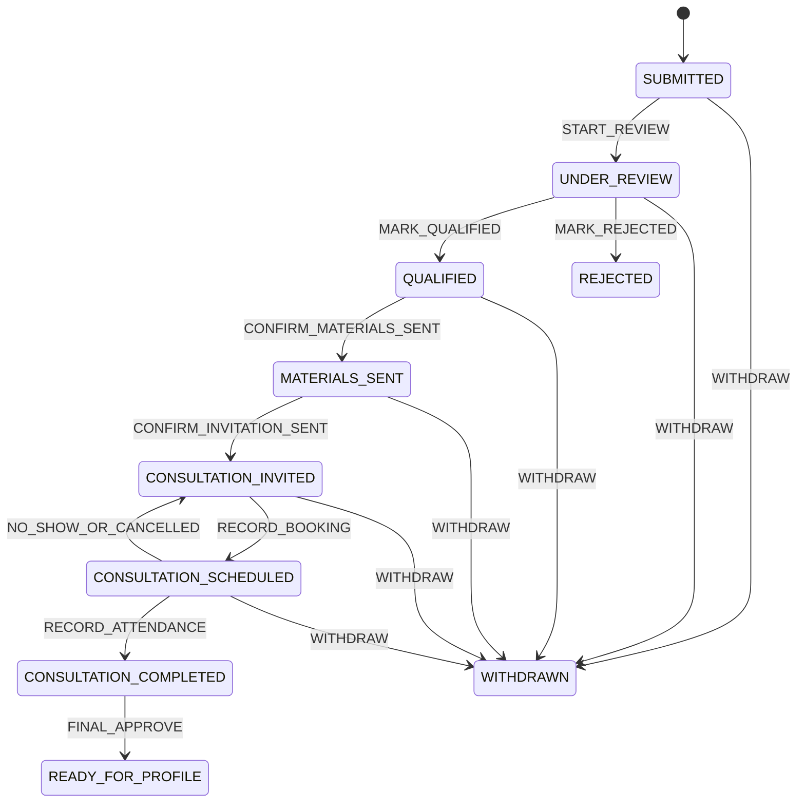

# Domain Specification: SWT Pre-Application, Selection, and Consultation

- Status: Accepted for MVP implementation; review required before production
- Version: 0.3
- Date: 2026-08-26
- Decision owners: American Adventure project team
- Related architecture: [ADR-0002](../adr/0002-target-application-architecture.md)
- Related scope change: [CR-0001](../change-requests/0001-admin-portal-replaces-application-email.md)
- Candidate content: [SWT MVP Candidate Information Pack](../content/swt-mvp-candidate-information-pack.md)
- Primary requirements: FR-001-FR-015, FR-070, FR-072, FR-074, NFR-001, NFR-003-NFR-006, BR-001-BR-006, WEB-03-WEB-05, WEB-10

## 1. Purpose

This document translates the contractual requirements for the Summer Work and Travel (SWT) pre-application process into an implementable domain model.

It defines:

- the public form contract;
- the difference between a pre-application and a candidate account;
- actors and permissions;
- workflow states and allowed transitions;
- contact, selection, document, consultation, and approval rules;
- automation events and failure behavior;
- administration, filtering, export, audit, and acceptance scenarios;
- decisions that must be confirmed before production implementation.

This is a business specification. It intentionally does not select a particular email, calendar, or hosting provider.

## 2. Source and interpretation

The normative sources are PRILOG 1A and PRILOG 1B.

The following interpretation rules apply:

1. A person who submits the public form is a potential applicant, not yet an authenticated candidate.
2. A stored pre-application in the dedicated authenticated Admin portal is the system of record. Application personal data is not sent to staff by email in the MVP.
3. Program configuration determines the form, Admin-portal routing, required materials, applicant message templates, and workflow.
4. All SWT form fields are required except the applicant note.
5. Privacy consent is required. Newsletter consent is separate and optional.
6. The business workflow stops when an applicant is rejected.
7. Integration failures are operational conditions and must not silently rewrite business decisions.
8. Ambiguous contractual wording is recorded as an open decision rather than hidden in code.
9. The MVP portal decision intentionally differs from FR-002, which requires routing every application to a program email. This deviation requires written contractual alignment or an approved change request before contractual acceptance.

## 3. Scope

### 3.1 Included in the first vertical slice

- public SWT pre-application form;
- server-side validation and spam protection;
- transactional persistence of the application and consent evidence;
- a dedicated authenticated Admin portal with an in-app work queue and detail view;
- no staff email containing the submitted application data;
- central administration list and detail view;
- manual pre-application creation by an authorized administrator;
- search, combined filters, sorting, pagination, and XLSX export;
- initial contact history;
- qualification or rejection decision;
- required-material delivery;
- consultation invitation and booking;
- attendance and consultation notes;
- final gate to `READY_FOR_PROFILE`;
- background-job reliability, audit, and access control.

### 3.2 Explicitly outside this slice

- candidate sign-up, login, and portal;
- contract generation or electronic acceptance;
- pricing, discounts, invoices, and payments;
- full dynamic candidate application;
- passport OCR and later document collection;
- job placement, visa, travel, and USA support;
- complete migration of all public program pages.

The model must allow these later capabilities without turning a pre-application into a candidate account prematurely.

## 4. Domain language

| Term | Meaning |
|---|---|
| `Applicant` | A person identity and contact record. It does not imply eligibility or an account. |
| `PreApplication` | A program-specific submission and its immutable submitted-value snapshot. |
| `CandidateProfile` | A later authenticated profile, created only after the readiness gate. |
| `Program` | Configuration root for form schema, destination email, workflow, materials, and templates. |
| `Campaign` | Optional program cycle, for example SWT 2027, used to keep yearly configuration separate. |
| `ContactAttempt` | A dated record of an agency contact attempt and its outcome. |
| `SelectionDecision` | An authorized qualification or rejection decision with evidence and actor. |
| `MaterialBundleAssignment` | The exact version of required materials assigned to an application. |
| `Consultation` | A booking and attendance record tied to one pre-application. |
| `FinalApproval` | An explicit authorized decision that all readiness conditions are satisfied. |
| `MessageDelivery` | The versioned message, recipient, attempts, provider reference, and result. |
| `AuditEvent` | An append-only record of a relevant actor action or system event. |

A `PreApplication` must never be treated as a login account. The later conversion creates or links a `CandidateProfile` while retaining the original submission and history.

## 5. Actors and permissions

| Actor | Allowed actions |
|---|---|
| Potential applicant | Submit the public form and receive a generic confirmation. No administration access. |
| Worker / Admin | In the MVP, every authenticated Admin may view all pre-applications, create manual applications, record contacts, qualify or reject, manage consultations, enter notes, export data, and give final approval. |
| Super Admin | All Admin capabilities plus program configuration, templates, integrations, role permissions, and privileged workflow correction. |
| System / Worker process | Validate commands, run automation, process webhooks, retry delivery, and append audit events. |

Rules:

- every administration action requires an authenticated server-side authorization check;
- UI visibility is not an authorization boundary;
- every authenticated Admin may export in the MVP, and every export creates an audit event;
- privileged correction or reopening requires Super Admin permission and a mandatory reason;
- ordinary administrators cannot hard-delete applications, decisions, consent evidence, deliveries, consultations, or audit events.

## 6. SWT public form contract

The program is selected by the page or route context. The server resolves the active program and campaign; it does not trust a display label sent by the browser.

| Field | Required | Proposed canonical representation | Validation notes |
|---|---:|---|---|
| First name | Yes | `firstName` | Trimmed text; preserve correct diacritics. |
| Last name | Yes | `lastName` | Trimmed text; preserve correct diacritics. |
| Date of birth | Yes | `dateOfBirth` | Valid calendar date; cannot be in the future. Eligibility age rules remain program configuration. |
| Full residential address | Yes | `residentialAddress` | One submitted snapshot plus later structured-address evolution if required. |
| Phone | Yes | `phone` | Store normalized form and original input; do not reject valid international numbers by Serbian-only formatting. |
| Email | Yes | `email` | Trim, normalize domain casing, validate syntax, retain submitted value for evidence. |
| Faculty name | Yes | `facultyName` | Configurable maximum length. |
| City of study | Yes | `studyCity` | Trimmed text or configured option while retaining the submitted label. |
| Current study year | Yes | `currentStudyYear` | MVP codes: `YEAR_1`-`YEAR_6`, `MASTER`, `DOCTORAL`, `OTHER`; store the displayed label with the submitted snapshot. |
| Renewed or paused year | Yes | `studyInterruptionStatus` | MVP codes: `NONE`, `RENEWED_YEAR`, `PAUSED_YEAR`, `OTHER`; `OTHER` requires a short explanation. |
| ESPB points | Yes | `espbPoints` | Non-negative integer. No contractual upper limit is assumed. |
| Applicant note | No | `applicantNote` | Plain text; configurable maximum length; never rendered as HTML. |
| Privacy consent | Yes | `privacyConsent` | Must reference the accepted text version and acceptance timestamp. |
| Newsletter consent | No | `newsletterConsent` | Separate choice and evidence; never inferred from privacy consent. |

The SWT form must not include Global TESOL College or Dual Diploma.

### 6.1 System-captured metadata

The server records:

- application ID;
- program and campaign IDs;
- source: `PUBLIC_WEB` or `ADMIN_MANUAL`;
- submission language and source page;
- creation time in UTC;
- request or correlation ID;
- form-schema version;
- privacy and newsletter text versions;
- approved technical consent evidence;
- creating Admin ID for manual entries.

Raw technical data must be minimized and retained only according to an approved privacy and retention decision.

### 6.2 Validation behavior

- client-side validation improves usability, but server-side validation is authoritative;
- all required fields must reject missing, blank, or structurally invalid values;
- privacy consent must be explicitly true;
- newsletter consent may be false or absent;
- unexpected fields are ignored or rejected according to the versioned schema and never silently persisted as trusted domain fields;
- validation errors identify fields without exposing internal details;
- controlled failures return a correlation ID and never expose stack traces, secrets, tokens, or other applicants' data;
- rate limiting, bot detection, and a server-side spam control apply before expensive work;
- accessibility errors are associated with form fields and usable by keyboard and assistive technology.

### 6.3 MVP consent and retention defaults

The following copy is a provisional product default and requires legal/privacy review before production use.

Required privacy checkbox:

> Saglasan/na sam da American Adventure DOO obrađuje podatke iz ove prijave radi razmatranja prijave, kontakta i organizacije konsultacija, u skladu sa Politikom privatnosti.

Optional newsletter checkbox:

> Želim da primam novosti, ponude i informacije o programima American Adventure. Saglasnost mogu da povučem u bilo kom trenutku.

Each consent record stores the consent type, boolean choice, exact text-version ID, UTC timestamp, application ID, source page, and request correlation ID. IP address and user-agent data are not copied into the consent record by default. Short-lived security logs may retain minimized technical data for 30 days.

MVP retention default:

- a pre-application that never becomes a candidate profile is retained for 24 months after its latest workflow activity, then queued for anonymization;
- a converted application follows the later candidate-record retention policy;
- newsletter consent follows its own lifecycle and may be withdrawn independently;
- the retention duration is configuration, not a hard-coded constant;
- production deletion/anonymization remains disabled until the final privacy policy and legal basis are approved;
- development and staging use synthetic data only.

## 7. Submission command and transaction

A valid public submission performs one atomic transaction:

1. resolve the active program, campaign, and form-schema version;
2. validate and normalize the submitted values;
3. create or link an `Applicant`;
4. create the `PreApplication` and submitted-value snapshot;
5. create privacy and optional newsletter `ConsentRecord` entries;
6. create the initial workflow record in `SUBMITTED`;
7. append `PRE_APPLICATION_SUBMITTED` to the transactional outbox;
8. append the initial audit event.

Only after the transaction commits does the API return success.

The background worker consumes the outbox event and creates an in-app notification or work-queue entry in the dedicated Admin portal. The MVP does not email the submitted personal data to staff.

FR-002 and PRILOG 1B name `beograd@workandtravel.rs` as the SWT destination. The project team's MVP decision replaces that delivery with portal access. This must be recorded in the contractual change-control process before acceptance against the original specification.

The public response does not depend on a notification provider. If creation of the in-app notification fails, the saved application still appears in the Admin list and the notification can be rebuilt from the outbox event.

### 7.1 Idempotency

- the public endpoint accepts or creates an idempotency key;
- replaying the same request with the same key returns the original result and does not create a second application;
- every background job and webhook has its own stable idempotency key;
- idempotency does not replace duplicate-person detection.

## 8. Potential duplicates

Email is useful for matching but is not a guaranteed unique human identity.

The system may flag potential duplicates using program/campaign plus combinations of:

- normalized email;
- normalized phone;
- first name, last name, and date of birth.

A suspected duplicate is not automatically rejected or merged. Authorized staff review it. Any later merge or link operation must preserve both submitted snapshots, all consent evidence, and a full audit trail.

## 9. Core records and ownership

| Record | Required ownership and invariants |
|---|---|
| `Program` | Owns program configuration, destination, active campaign, and workflow references. |
| `Applicant` | Owns normalized identity/contact data; may link to multiple applications over time. |
| `PreApplication` | Owns program, campaign, source, current workflow version, and immutable submitted snapshot. |
| `ConsentRecord` | Owns consent type, text version, choice, timestamp, and approved evidence. |
| `ContactAttempt` | Belongs to one application and records actor, channel, time, outcome, and optional note. |
| `SelectionDecision` | Belongs to one application; records decision, reason, actor, and time. |
| `MaterialBundleAssignment` | References an immutable material-bundle version used for this application. |
| `Consultation` | Belongs to one application; stores provider reference, schedule, time zone, lifecycle, attendance, and notes. |
| `FinalApproval` | Belongs to one application and records the approving actor and checklist result. |
| `MessageDelivery` | References exact template/content version and provider attempts. |
| `OutboxEvent` | Guarantees reliable work scheduling in the same transaction as the domain change. |
| `AuditEvent` | Append-only record of relevant changes without secret values. |

Concurrent administration changes use a record version or equivalent optimistic concurrency check. A stale screen cannot silently overwrite a newer decision.

## 10. Workflow state machine

The main business state is intentionally separate from contact outcomes, message delivery status, and consultation lifecycle.

`REJECTED`, `WITHDRAWN`, and `READY_FOR_PROFILE` are terminal for the pre-application workflow. A privileged correction creates a new audited transition; it never rewrites history.

### 10.1 Transition rules

| Command | From -> To | Actor | Required guards | Atomic effects |
|---|---|---|---|---|
| `START_REVIEW` | `SUBMITTED -> UNDER_REVIEW` | Admin | Authorized access; current version matches | Assign/start processing and audit. |
| `MARK_QUALIFIED` | `UNDER_REVIEW -> QUALIFIED` | Admin | At least one contact attempt; a successful conversation is not mandatory; current version matches | Save positive decision, enqueue exact material bundle, audit. |
| `MARK_REJECTED` | `UNDER_REVIEW -> REJECTED` | Admin | At least one contact attempt; rejection reason is mandatory | Save decision, cancel pending continuation work, audit. |
| `CONFIRM_MATERIALS_SENT` | `QUALIFIED -> MATERIALS_SENT` | System or privileged manual override | Exact bundle assigned; successful delivery evidence or override reason | Save delivery link/result, enqueue consultation invitation, audit. |
| `CONFIRM_INVITATION_SENT` | `MATERIALS_SENT -> CONSULTATION_INVITED` | System or privileged manual override | Material delivery completed; invitation delivery evidence or override reason | Save delivery and audit. |
| `RECORD_BOOKING` | `CONSULTATION_INVITED -> CONSULTATION_SCHEDULED` | System or Admin fallback | Unique provider booking reference, or manual-entry reason; valid time zone | Create/update consultation idempotently and audit. |
| `RECORD_ATTENDANCE` | `CONSULTATION_SCHEDULED -> CONSULTATION_COMPLETED` | Admin | Consultation time has passed; attendance is `ATTENDED` | Save attendance, actor, time, and optional notes; audit. |
| `NO_SHOW_OR_CANCELLED` | `CONSULTATION_SCHEDULED -> CONSULTATION_INVITED` | System or Admin | Consultation lifecycle is `NO_SHOW` or `CANCELLED` | Preserve old consultation, allow a new booking, audit. |
| `FINAL_APPROVE` | `CONSULTATION_COMPLETED -> READY_FOR_PROFILE` | Admin | All readiness gates pass; explicit final approval | Save approval, emit `PRE_APPLICATION_READY_FOR_PROFILE`, audit. |
| `WITHDRAW` | Any listed non-terminal state -> `WITHDRAWN` | Admin | Reason and source of request recorded | Cancel pending continuation work and audit. |

### 10.2 Readiness gates

`READY_FOR_PROFILE` is allowed only when all applicable conditions are true:

- the selection decision is `QUALIFIED`;
- the assigned required-material bundle was sent or made available successfully;
- a consultation is linked to this application;
- attendance is `ATTENDED`;
- an authorized Admin has recorded final approval;
- the current workflow version has not changed since the readiness check began.

For the MVP, the candidate is not required to confirm reading or receipt. `MATERIALS_SENT` is supported by the system's delivery record only. The PRILOG 1A wording about reading a sent contract is deferred for later contractual clarification and must not be represented as completed acknowledgement.

## 11. Contact model

Contact history is not a single checkbox.

Each `ContactAttempt` records:

- channel: initially `PHONE`, extensible to approved channels;
- attempted-at timestamp in UTC;
- Admin actor;
- outcome: `NO_ANSWER`, `REACHED`, `CALLBACK_REQUESTED`, `INVALID_CONTACT`, or configured equivalent;
- optional next-contact time;
- optional plain-text note.

Derived contact status for lists and filters:

- `NOT_ATTEMPTED`;
- `ATTEMPTED`;
- `REACHED`;
- `FOLLOW_UP_REQUIRED`.

The latest-contact time is derived from history, not manually overwritten.

At least one contact attempt remains part of the contractual workflow, but its outcome does not block a positive selection decision in the MVP.

## 12. Automation and failure rules

| Domain event | Automated action | Success result | Failure behavior |
|---|---|---|---|
| `PRE_APPLICATION_SUBMITTED` | Create an in-app Admin notification or work-queue item | Application is immediately visible in the dedicated portal | Rebuild or retry the notification; the saved application remains visible. |
| `SELECTION_QUALIFIED` | Assign versioned material bundle and email applicant | Transition to `MATERIALS_SENT` only after approved success condition | Remain `QUALIFIED`; show failure and retry. |
| `MATERIALS_SENT` | Send a second email with approved consultation link | Transition to `CONSULTATION_INVITED` | Remain `MATERIALS_SENT`; show failure and retry. |
| `CONSULTATION_BOOKED` | Persist booking and optionally notify staff | Consultation is visible beside application | Reject invalid signature; retry processing without duplication. |
| `SELECTION_REJECTED` or `PRE_APPLICATION_WITHDRAWN` | Cancel not-yet-sent continuation jobs | No later workflow email is sent | Cancellation result remains auditable. |
| `PRE_APPLICATION_READY_FOR_PROFILE` | Notify the later profile-provisioning module | Event waits for phase 2 consumer | Never create a partial account inside this workflow. |

Operational statuses such as `PENDING`, `PROCESSING`, `DELIVERED`, `FAILED`, and `RETRYING` belong to delivery/job records, not the main business state.

Messages reference an immutable template/content version. A template edit must not change the historical message record.

### 12.1 MVP email adapter default

The MVP uses Resend behind the provider-neutral email adapter.

- sending subdomain: `notify.workandtravel.rs`;
- sender: `American Adventure <noreply@notify.workandtravel.rs>`;
- default reply-to: `beograd@workandtravel.rs`, configurable by program;
- message categories: required-material delivery and consultation invitation only;
- staff do not receive application personal data by email;
- SPF and DKIM must pass before production sending;
- DMARC starts in monitoring mode and moves to `quarantine` or `reject` only after verified delivery;
- delivery, bounce, and complaint webhooks use raw-body signature verification and idempotent event storage;
- provider secrets exist only in the deployment secret store.

Resend is an MVP implementation choice, not a domain dependency. A later provider can replace it without changing workflow commands or historical delivery records.

## 13. Consultation integration

- the provider is accessed through an adapter and is not named in domain logic;
- webhook signatures and timestamps are verified;
- `provider + externalBookingId` is unique;
- replayed webhooks return success without duplicating a consultation;
- schedule start and end are stored in UTC together with the original time-zone identifier;
- rescheduling updates the active booking while preserving event history;
- cancellation and no-show do not erase the booking;
- authorized staff may enter a booking manually only with a source and reason;
- consultation notes are visible only to authorized roles and are never included in general email notifications or public responses.

### 13.1 MVP Calendly default

The MVP uses Calendly through the calendar adapter:

- one 30-minute event type named `SWT konsultacije`;
- default display time zone `Europe/Belgrade`, while storing UTC and the original zone;
- an internal integration authenticated with a dedicated personal access token;
- an organization-scoped webhook subscription for `invitee.created` and `invitee.canceled`;
- an opaque signed application reference in tracking data, never raw personal data in the booking URL;
- rescheduling is processed as the linked cancellation plus creation pair;
- a valid repeated webhook returns success without creating another consultation;
- Admin manual booking remains the fallback when the subscription or provider is unavailable.

Calendly webhooks require an eligible paid plan. The production account, event type, token, and webhook URL are deployment configuration and are never committed to the repository.

## 14. Dedicated Admin portal, search, and export

The default list shows at least:

- applicant name;
- program and campaign;
- submitted date;
- email and phone;
- city and current study year;
- workflow state;
- derived contact status and last-contact time;
- consultation time when present;
- delivery warning when automation needs attention;
- source and potential-duplicate indicator.

Required combined filters:

- program and campaign;
- submission date range;
- workflow state;
- contact status;
- name, email, and phone search;
- city of study;
- current study year;
- interruption status;
- ESPB points or approved ranges;
- public versus manual source;
- consultation date or state;
- delivery-failure indicator.

Rules:

- the portal requires an authenticated Admin session and server-side authorization;
- every authenticated Admin may access all pre-applications and operational actions in the MVP;
- filtering, sorting, and pagination are server-side;
- exports use the exact active filter set, authorized columns, and stable column headers;
- XLSX generation must safely encode spreadsheet-formula-leading input;
- each export records actor, time, filters, row count, and result;
- authorization applies to every returned row and column, not only to opening the page.

## 15. Manual creation

An authorized Admin may create a pre-application manually.

The same domain validation applies, with these additions:

- source is `ADMIN_MANUAL`;
- the creating Admin is recorded;
- the original acquisition channel is recorded when known;
- privacy consent is not invented: approved consent evidence or another approved collection basis must be recorded;
- any bypass of a public-only spam check does not bypass business validation;
- automation follows the same program configuration unless the Admin explicitly selects an approved manual-notification option.

## 16. Audit and data protection

Audit events are required for:

- public or manual creation;
- consent evidence and versions;
- workflow transitions and rejected transition attempts;
- contact attempts;
- qualification, rejection, final approval, withdrawal, and privileged reopening;
- manual overrides;
- message attempts and final delivery results;
- consultation booking, rescheduling, cancellation, attendance, and notes changes;
- export requests and results;
- role and program-configuration changes.

Audit records identify who, what, when, target record, previous state, new state, and correlation ID. They must not store passwords, tokens, provider secrets, or unnecessary full message bodies.

The MVP implements the configurable 24-month non-converted pre-application retention rule described in section 6.3, but production anonymization remains disabled until legal/privacy approval. No ordinary UI action performs permanent deletion. Sensitive notes are available to every authenticated Admin in the MVP and remain auditable; finer-grained access is a post-MVP hardening item.

## 17. Acceptance scenarios

1. A valid SWT submission is stored once, linked to the active SWT program/campaign, and immediately visible to an authorized Admin.
2. Missing any required SWT field returns a field-level validation error and creates no partial application.
3. A form without privacy consent cannot be submitted.
4. A form without newsletter consent can be submitted and does not create an affirmative newsletter subscription.
5. Replaying the same idempotency key does not create a duplicate application or duplicate notification.
6. A successful submission immediately appears in the dedicated Admin portal and creates an in-app work-queue notification without emailing the submitted personal data.
7. Failure of the in-app notification worker does not lose or hide the application; the portal list remains the authoritative queue.
8. An Admin can create a manual application with actor and collection-basis evidence.
9. An unauthorized user cannot view, change, or export applications.
10. Combined filters return only matching records and the XLSX contains exactly the authorized filtered set.
11. Recording a contact attempt preserves actor, outcome, time, note, and latest-contact derivation.
12. Rejection without a reason is refused and no continuation automation is scheduled.
13. Qualification schedules exactly one versioned material-bundle delivery.
14. A failed material email does not falsely advance the application to `MATERIALS_SENT`.
15. The consultation invitation is not sent before successful material delivery or an audited approved override.
16. A valid booking webhook links the exact booking and time zone to the correct application.
17. Replaying a booking webhook does not create a second consultation.
18. Cancellation or no-show preserves history and allows a new booking.
19. `READY_FOR_PROFILE` is refused unless every configured readiness gate and final approval pass.
20. Every critical action displays or records the responsible actor and timestamp.
21. A stale Admin update is rejected instead of overwriting a newer workflow decision.
22. Controlled errors expose no stack trace, token, provider secret, or another applicant's personal data.
23. Only configured study-year and interruption-status values are accepted, and `OTHER` interruption requires an explanation.
24. The exact privacy/newsletter text version and choice are retained with the application.
25. A non-converted record becomes eligible for anonymization 24 months after its latest workflow activity, while the production job remains gated by privacy approval.
26. Resend and Calendly webhook replays are signature-checked and processed idempotently.

## 18. Traceability

| Requirement | Covered by |
|---|---|
| FR-001, WEB-03-WEB-05 | Sections 6-7 and scenarios 1-5 |
| FR-002 | Intentionally replaced in the MVP by the dedicated Admin portal; written contractual alignment is required. |
| FR-072 | Section 12 for applicant-facing messages; application personal data is not emailed to staff. |
| FR-003-FR-005, FR-074 | Section 14 and scenarios 8-10 |
| FR-006 | Section 11 and scenario 11 |
| FR-007-FR-010, BR-004-BR-005 | Sections 10 and 12; scenarios 12-14 |
| FR-011-FR-014, BR-006 | Sections 10, 12, and 13; scenarios 15-18 |
| FR-015, BR-001-BR-003 | Sections 3, 4, and 10; scenario 19 |
| FR-070, NFR-005 | Section 16 and scenarios 20-21 |
| NFR-003-NFR-004 | Sections 5, 6, 14, and 16; scenarios 9 and 22 |
| NFR-001, NFR-006, WEB-10 | Section 6 and scenarios 2 and 22 |

## 19. MVP decisions and configurable defaults

### Decisions approved for MVP implementation

1. Submitted application data is reviewed in a separate authenticated Admin portal and is not sent to staff by email.
2. The initial required-material bundle is the project-authored `SWT MVP Candidate Information Pack`.
3. The candidate does not need to confirm reading or receipt.
4. A successful phone conversation is not mandatory; at least one contact attempt is recorded.
5. Every authenticated Admin may view, qualify, reject, add consultation notes, export, and final-approve.
6. Super Admin permission is required for configuration, role management, and privileged history-preserving corrections.
7. Study years use `YEAR_1`-`YEAR_6`, `MASTER`, `DOCTORAL`, and `OTHER`.
8. Interruption status uses `NONE`, `RENEWED_YEAR`, `PAUSED_YEAR`, and `OTHER`.
9. Provisional consent copy and a configurable 24-month non-converted retention default are used for MVP implementation.
10. Resend is the applicant-facing email adapter default.
11. Calendly is the consultation adapter default, with a 30-minute `SWT konsultacije` event type.
12. The American Adventure Product Owner owns candidate-pack content; a Super Admin publishes versions.

### Production release gates

These do not block schema, API, or non-production MVP development, but they block real candidate data or production messaging:

1. legal/privacy approval of consent wording, legal basis, and retention;
2. contractual approval of Change Request CR-0001 replacing FR-002 email delivery with the Admin portal;
3. DNS verification and deliverability testing for the sending subdomain;
4. creation of the Calendly production event type, paid webhook-capable plan, token, and subscription;
5. Product Owner approval of the exact candidate-pack version and official contact values;
6. a documented test of anonymization, webhook replay handling, and provider failure recovery.

### Defaults that remain configurable without a new architecture decision

- contact outcome labels and follow-up reminders;
- duplicate-warning thresholds;
- assignment of applications to workers;
- service-level targets for first contact;
- campaign-specific ESPB and age eligibility rules;
- retention duration after legal approval;
- email and calendar providers behind their adapters;
- list columns and saved Admin filter presets.

## 20. Definition of ready for coding

This specification is accepted for MVP implementation. Database and API work may begin when:

- acceptance scenarios are copied into the implementation backlog;
- CR-0001 is linked from the implementation work;
- provider credentials are represented only by documented environment-variable placeholders;
- development and automated tests use synthetic candidate data.

Production release remains prohibited until every production release gate in section 19 is complete.

## 21. Official implementation references

- [Resend domain verification](https://resend.com/docs/dashboard/domains/introduction)
- [Resend DMARC guidance](https://resend.com/docs/dashboard/domains/dmarc)
- [Resend webhook verification](https://resend.com/docs/webhooks/verify-webhooks-requests)
- [Calendly API introduction](https://developer.calendly.com/getting-started)
- [Calendly webhook subscriptions](https://developer.calendly.com/receive-data-from-scheduled-events-in-real-time-with-webhook-subscriptions)
- [Calendly rescheduling behavior](https://developer.calendly.com/see-how-webhook-payloads-change-when-invitees-reschedule-events)
